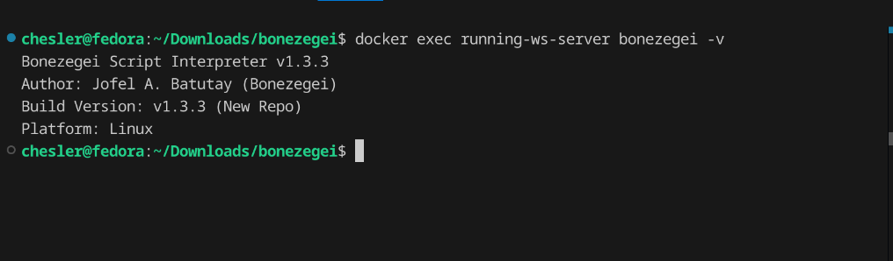
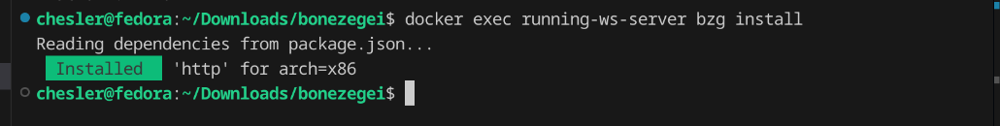
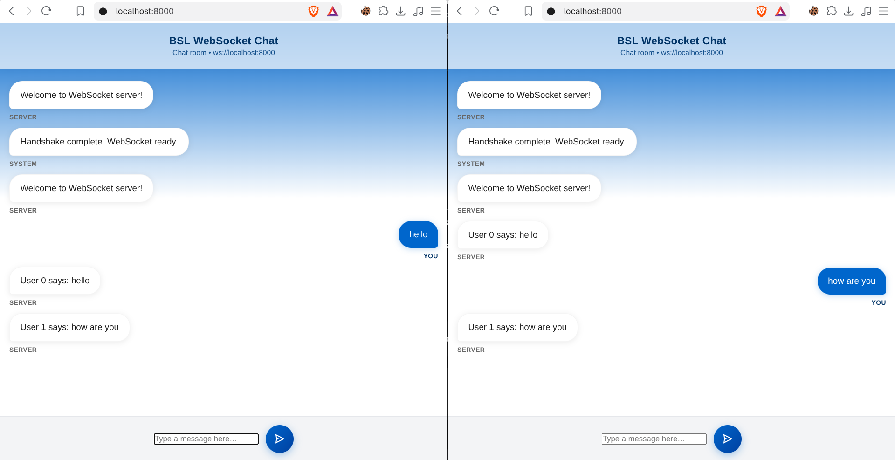
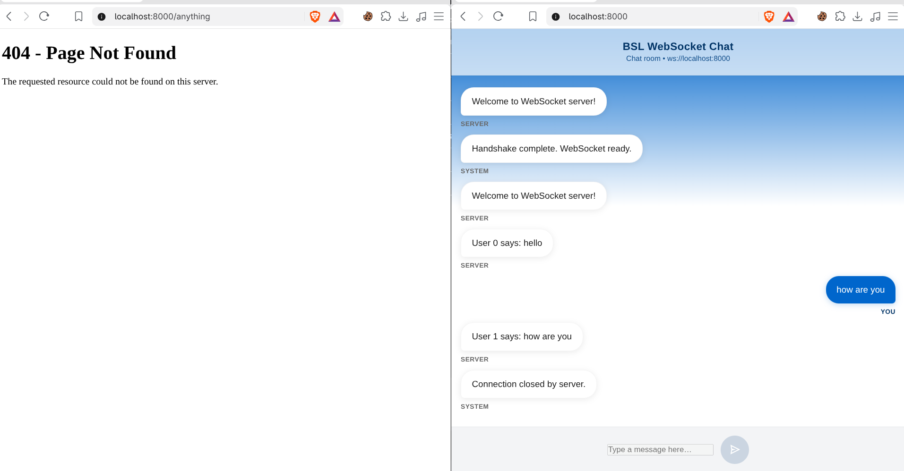

# ITE183 Laboratory 2: WebSocket Server

A multi-client WebSocket chat server written in Bonezegei Scripting Language (BSL v1.3.3) for ITE183 (Web Systems and Technologies).

The server listens on port 8000, serving the static chat interface on `/` and handling WebSocket connections on `ws://localhost:8000`. Unmatched HTTP routes return a custom 404 page. All incoming messages from any client are broadcast to every connected client using `server.sendAll()`.

## Project Structure

```
.
├── app.bzg              # Server entry point (HTTP routing and WebSocket events)
├── package.json         # BSL package manifest (http dependency)
├── .gitattributes       # Sets *.bzg syntax highlighting to JavaScript
├── README.md            # Lab documentation
├── LICENSE              # MIT License
├── Dockerfile           # Ubuntu 24.04 environment with BSL v1.3.3
├── public/
│   ├── index.html       # Chat client interface
│   └── 404.html         # Custom 404 error page
├── documentation/       # Verification screenshots
│   ├── version.png      # Engine version verification (v1.3.3)
│   ├── install.png      # Dependency installation (bzg install)
│   ├── chat.png         # Multi-client chat broadcast
│   └── 404.png          # 404 fallback page
└── pkg/
    └── Bonezegei-x86.deb  # BSL engine installer v1.3.3
```

## Requirements

- Bonezegei Script Interpreter **v1.3.3**
- `bzg` package manager (installed with the engine)

### Ubuntu / Debian (native)

```bash
wget https://github.com/bonezegei/Bonezegei_Scripting_Language/raw/refs/heads/main/Release/Latest/Bonezegei-x86.deb
sudo apt install ./Bonezegei-x86.deb
bonezegei -v   # Verify version 1.3.3
```

### Fedora (Docker container)

Because Fedora uses RPM packages and does not have `apt`, run the server inside the provided Ubuntu 24.04 container:

```bash
# Build the image
docker build -t bonezegei-ws .

# Run the server
docker run -it -p 8000:8000 --name running-ws-server bonezegei-ws
```

To restart a stopped container:

```bash
docker start -ai running-ws-server
```

To remove and rebuild:

```bash
docker rm -f running-ws-server
docker run -it -p 8000:8000 --name running-ws-server bonezegei-ws
```

## How It Works

Port 8000 handles both HTTP and WebSocket traffic through BSL's `http` module:

| Handler | Event | Description |
| --- | --- | --- |
| `server.get` | HTTP GET | Serves `public/index.html` for `/`, and loads `public/404.html` with status code 404 for all other paths. |
| `server.onConnect` | Client connected | Fires on WebSocket handshake; logs the connection and sends a welcome message to the new client ID. |
| `server.onData` | Message received | Receives text payload from a client and calls `server.sendAll()` to broadcast it to all active clients. |
| `server.onDisconnect` | Client disconnected | Fires when a socket connection closes; logs the disconnection event. |

## Testing

1. Open `http://127.0.0.1:8000/` in two separate browser windows (use `127.0.0.1` rather than `localhost` if your system resolves localhost to IPv6 `::1`).
2. Type a message in window 1. Both windows should display the message in real time.
3. Visit `http://127.0.0.1:8000/anything` to verify the custom 404 page.

## Verification Screenshots

### Engine Version (v1.3.3)


### Dependency Installation


### Multi-Client Chat Broadcast


### 404 Error Handling


## Troubleshooting

| Issue | Resolution |
| --- | --- |
| Browser cannot connect | Check `docker ps` to verify the container is running, use `http://127.0.0.1:8000/` instead of `localhost`, and reload with `Ctrl+Shift+R`. |
| Port 8000 already bound | Check bound ports with `ss -ltnp | grep 8000` or map to another host port (e.g. `-p 8080:8000`). |
| Container name conflict | Run `docker rm -f running-ws-server` before creating a new container with the same name. |
